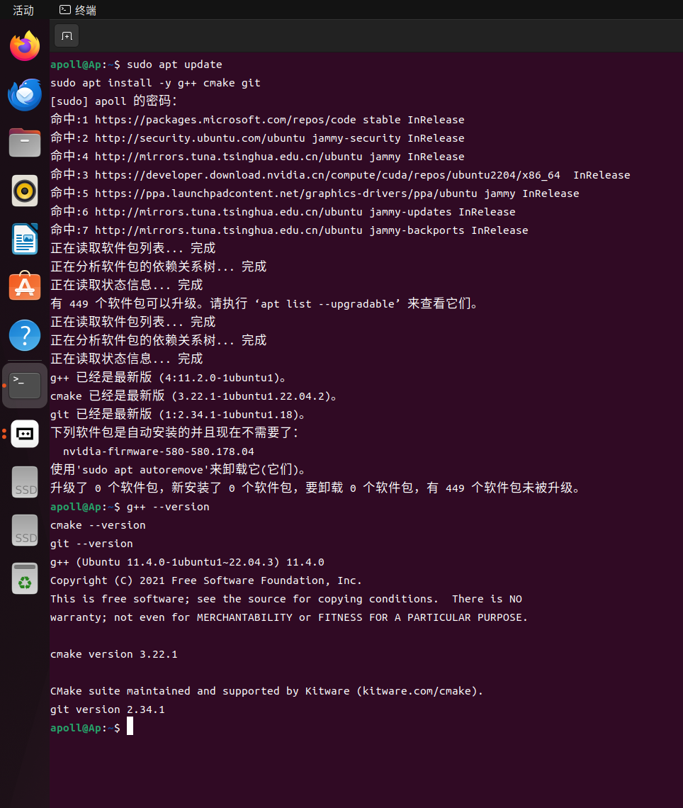

# 任务一：Hello Ubuntu & Git

> GitHub：@dantaipenghui-hue
> 完成时间：2026 年 10 月

## 一、任务目标

- 完成 Ubuntu 22.04 LTS 环境的部署与版本验证；
- 掌握 Git 基础操作：clone、add、commit、branch、merge 与冲突解决；
- 熟悉常用终端命令（详见 [commands.md](./commands.md)）。

## 二、环境说明

| 项目 | 内容 |
| ---- | ---- |
| 操作系统 | Ubuntu 22.04 LTS (Jammy Jellyfish) |
| 部署方式 | 实验室服务器（双系统物理安装） |
| 架构 | x86_64 |
| g++ | 11.4.0 |
| CMake | 3.22.1 |
| Git | 2.34.1 |

## 三、Ubuntu 22.04 部署方法

1. 从 Ubuntu 官网（或清华镜像站）下载 `ubuntu-22.04-desktop-amd64.iso`；
2. 使用 Rufus / Ventoy 制作 U 盘启动盘；
3. 在实验室服务器上从 U 盘启动，选择 **Install Ubuntu**；
4. 分区阶段选择与其他系统共存（双系统安装），划分 `/` 主分区与 swap 分区；
5. 按向导完成时区、用户名与密码设置，重启后进入 Ubuntu 22.04。

## 四、环境验证

在 Ubuntu 22.04 终端依次执行以下命令，完成软件源检查、开发工具链安装与版本验证：

```bash
sudo apt update                    # 更新软件源（源代号 jammy，即 Ubuntu 22.04）
sudo apt install -y g++ cmake git  # 安装 C++ 编译工具链与 Git
g++ --version                      # g++ (Ubuntu 11.4.0-1ubuntu1~22.04.3) 11.4.0
cmake --version                    # cmake version 3.22.1
git --version                      # git version 2.34.1
```



> 截图说明：`sudo apt update` 输出中的软件源代号为 `jammy`（Ubuntu 22.04 LTS 的官方代号，
> 并含 `jammy-security`、`jammy-updates` 等），`g++`、`cmake`、`git` 的版本字符串均含
> `22.04` / `ubuntu2204` 标识，可确认系统为 Ubuntu 22.04 LTS，且 C++ 开发工具链安装就绪。

## 五、Git 配置

```bash
sudo apt install git
git config --global user.name  "dantaipenghui-hue"
git config --global user.email "注册 GitHub 时使用的邮箱"
ssh-keygen -t ed25519          # 生成 SSH 密钥并添加到 GitHub
```

## 六、整改对照（评审意见 → 落实情况）

| 评审待改项 | 落实情况 |
| ---------- | -------- |
| 规范仓库名称 | 仓库已重命名为 `bjfu-nav-tantaipenghui` |
| 调整目录结构 | 已删除误建的 `task 1` 空白文件，规范使用 `task1/` 目录 |
| 补齐终端命令练习笔记 | 见 [commands.md](./commands.md) |
| 补齐环境验证与文档 | 即本 README（含版本验证截图） |
| 添加基础 .gitignore | 仓库根目录已添加 C++ 基础 `.gitignore` |
